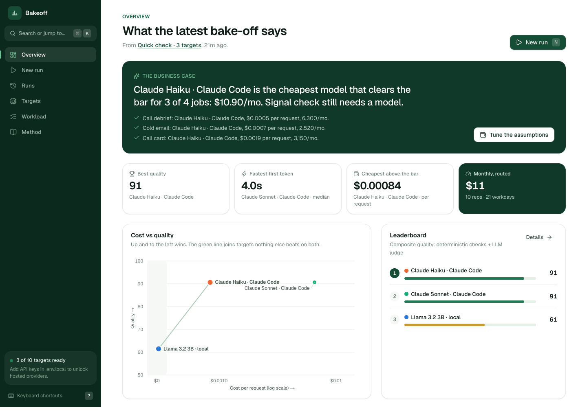
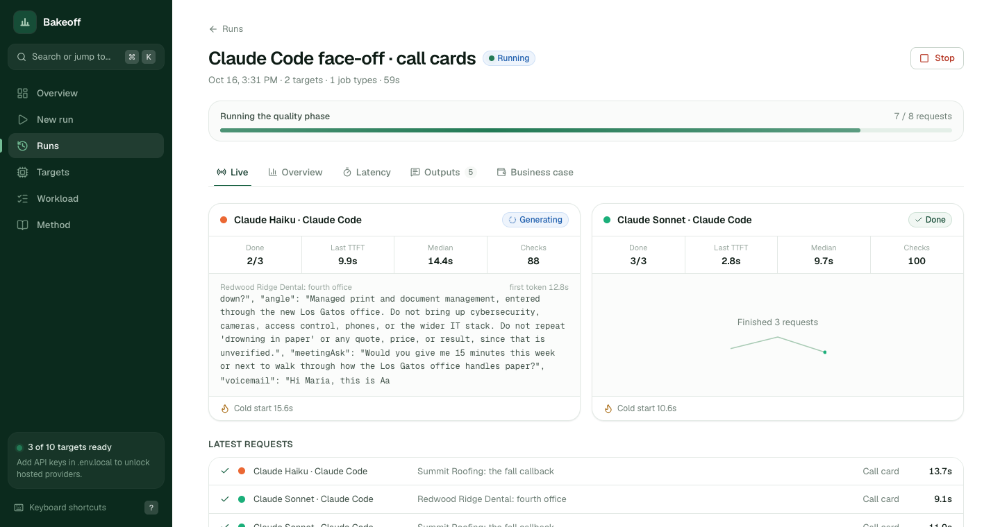
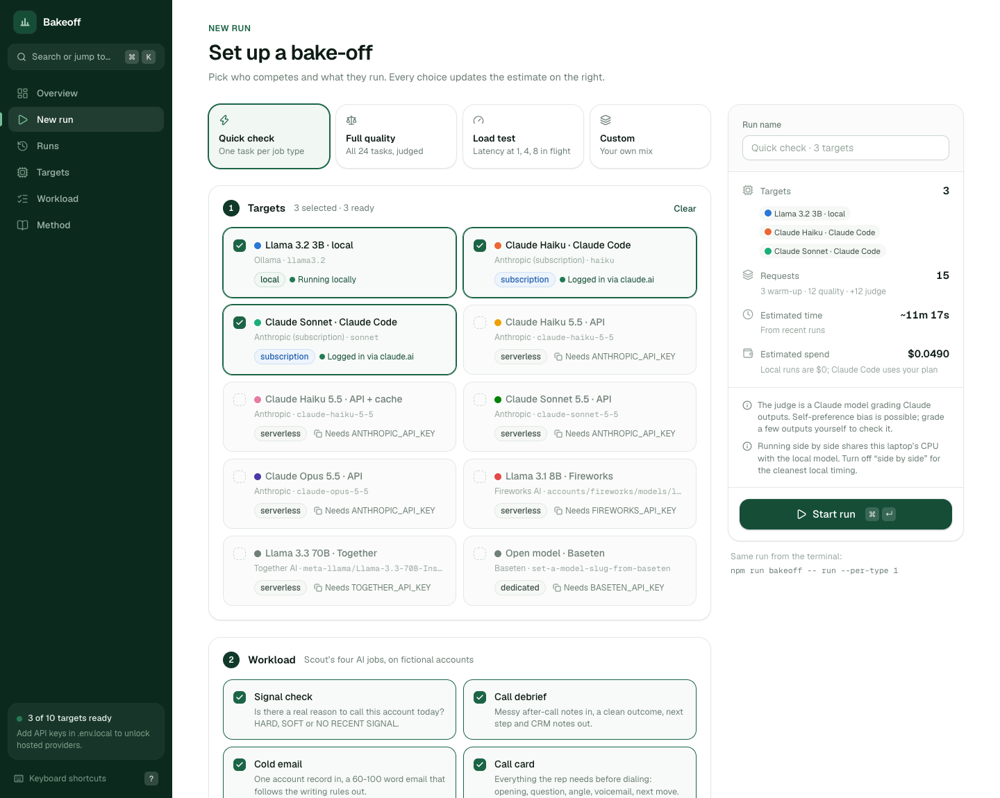
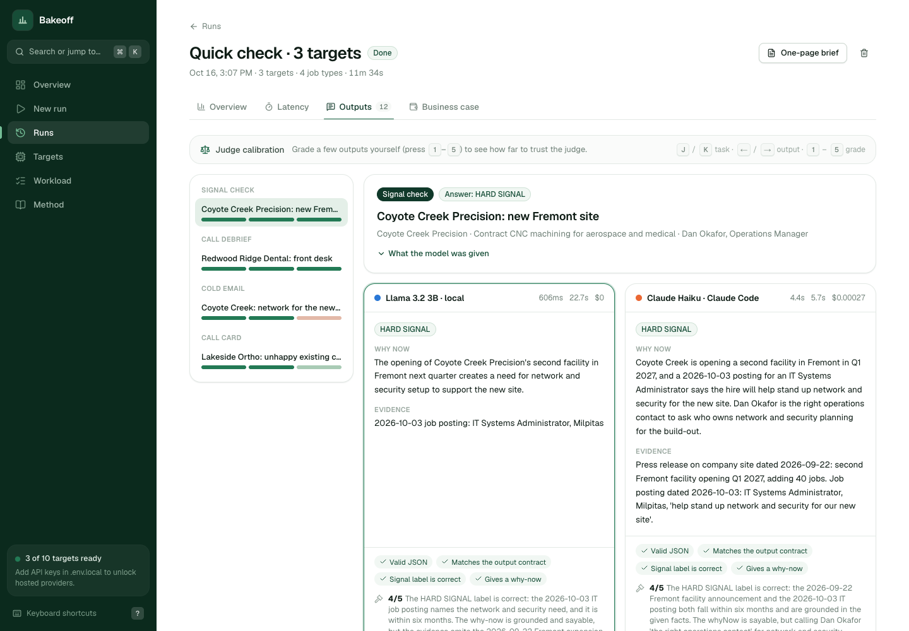
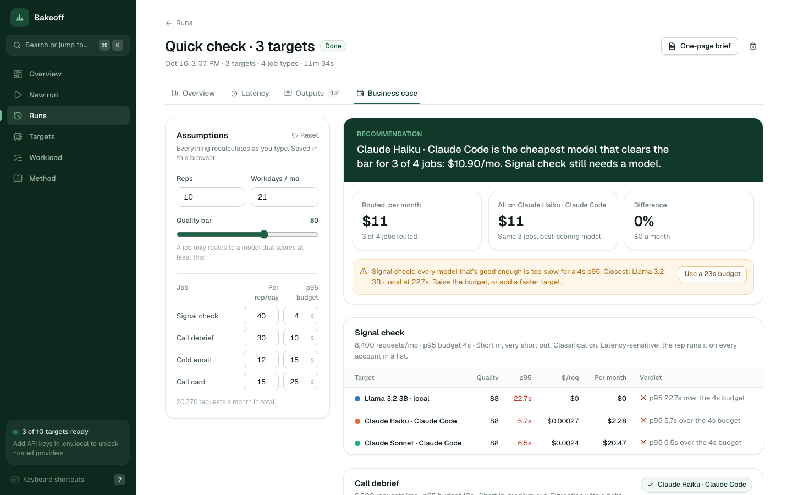
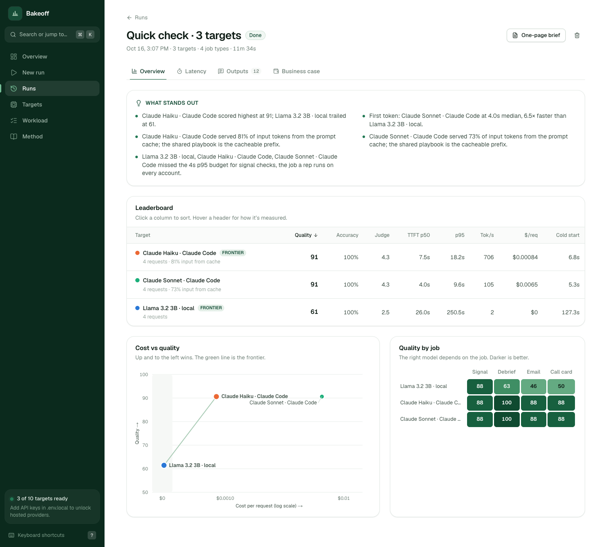
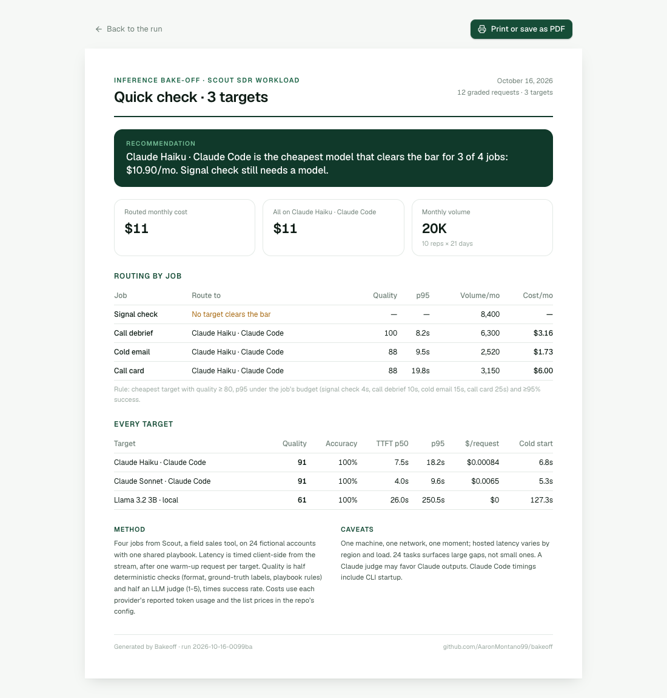

# Bakeoff

I sell technology for a living. For the last two years I've been selling managed IT, cybersecurity and infrastructure to companies in the Bay Area. More and more of the conversations I want to be in are about AI, and I noticed a gap in myself: I could talk about what AI products do, but not how they actually work underneath.

What happens between an app sending a prompt and the first word coming back? Why is one model fast and another slow on the same question? What does prompt caching really save? When does renting a GPU beat paying per token? How do you know a model's answer is any good, beyond reading it and nodding?

I didn't want to read about those questions. I wanted to measure them. So I built Bakeoff.



## What it is

Bakeoff takes the AI work from [Scout](https://github.com/AaronMontano99/scout), a prospecting tool I built for my own job and use every day, and runs it against different models: one on my laptop, Claude through my existing plan, and hosted providers when they have an API key. For every request it records how long the first token took, how long the whole answer took, what it cost and how good it was. Then it answers the question a buyer would actually ask: **which model should handle which job, and what will that cost a team per month?**

I used a real workload instead of made-up prompts because that's where the interesting answers are. Scout does four very different jobs:

| Job | Shape | What matters |
|---|---|---|
| **Signal check**: is there a real reason to call this account today? | short in, tiny out, runs on every account | speed, getting the label right |
| **Call debrief**: messy notes → outcome, next step, CRM notes | short in, medium out, has a right answer | accuracy, structure |
| **Cold email**: 60-100 words under strict style rules | medium in, medium out | quality, following the rules |
| **Call card**: opening, question, angle, voicemail | medium in, longest out | judgment |

A job a rep runs 40 times a day has different needs than the hardest job of the day. Measuring them separately is the whole point.

The 48 tasks use fictional accounts, so no customer data leaves my machine. 24 are "dev" tasks where Bakeoff makes its picks, and 24 are held-out tasks it only uses to check those picks (more on that below).

## What I wanted to understand, and what I found

These are the questions I started with. Each became something Bakeoff measures.

**What does "fast" actually mean?** It turned out to be at least three different things. *Time to first token* is how long you wait before anything appears. *Total time* is how long until the answer is done. *Tokens per second* is how fast it writes once it starts. In my first run, Claude Haiku generated text much faster than Sonnet but showed its first word later (7.5s vs 4.0s). My working hypothesis is that it reasons before writing anything visible. That's the kind of thing I'd never have noticed from a spec sheet.

**Why is the first request always slow?** Cold starts: loading a model into memory, opening a connection, starting a process. Bakeoff sends one warm-up request per model and reports it separately. On my 2017 laptop the local model took over two minutes for its first answer.

**What happens when lots of people use it at once?** The load test fires requests at 1, 4, 8 or 16 at a time and shows whether the slowest 5% of requests (p95) stay flat or start queueing.

**What does prompt caching really do?** Every Scout request starts with the same long playbook. With caching, the provider stores that prefix and charges far less to reuse it. In my first run, 73-81% of input tokens came from cache.

**How do you grade a model's answer?** Two ways, because each covers the other's blind spot. Deterministic checks catch what a script can verify: valid JSON, the right label, word limits, no banned phrases. An LLM judge grades the parts that need judgment, 1 to 5. Because a judge can be wrong, or biased toward its own model family, you can grade answers yourself and Bakeoff reports how often you and the judge agree.

**When does a dedicated GPU beat paying per token?** Per-token pricing wins at low volume. A reserved GPU wins once it stays busy. Bakeoff uses the throughput measured in the load test to find the break-even volume.

### First results (quick check, Oct 16 2026)

Four tasks (one per job) on the three models that need no API key:

| Model | Quality | First token (median) | p95 | Cost per request | Input from cache |
|---|---|---|---|---|---|
| Claude Haiku · Claude Code | 91 | 7.5s | 18.2s | $0.00084 | 81% |
| Claude Sonnet · Claude Code | 91 | 4.0s | 9.6s | $0.0065 | 73% |
| Llama 3.2 3B · my laptop | 61 | 26.0s | 250s | $0 | n/a |

- **Haiku matched Sonnet on quality at about an eighth of the cost.** Routing debriefs, emails and call cards to Haiku comes to about $11/month for a 10-rep team.
- **No model met the 4-second budget for signal checks.** Claude Code starts a new process for every request, which eats most of that budget. This is the job where a fast open model on a hosted inference provider should win, and it's what I'm testing next.
- **Free and local isn't the same as good enough.** The 3B model scored 46-63 on the writing and extraction jobs.

Four tasks only shows big differences. A full 24-task run with hosted providers is next.

## Update 1 (Oct 17 2026): from "which model looks best" to "prove the pick"

### Why I changed direction

I read "How to Be More Ambitious: A Tutorial for Humans with Models" by Felix Rieseberg (Oct 13 2026) and it named something I was doing wrong across all my projects: I was building features, not outcomes. Bakeoff's first version could rank models on a handful of tasks and print a routing plan. That looks like an answer, but it isn't one. With four tasks, "Haiku matched Sonnet" could easily be luck, and nothing in the tool would tell you.

The question a buyer actually needs answered isn't "which model scored highest?" It's **"if I route my traffic this way, will it still hold up on requests nobody has seen yet, and what does it save me?"** So this update makes Bakeoff take responsibility for that result, and gives it a way to be wrong out loud.

Three ideas from the article shaped it:

- **Go up a level.** The outcome is a routing decision someone could defend to their boss, not a leaderboard.
- **Use the methods a professional would.** Held-out data, confidence intervals and a pre-declared pass/fail rule, instead of averages and a gut check.
- **Don't let the model grade itself.** The verdict has to hold on the deterministic checks alone, the part of the score no LLM touches.

### What I added

- **24 new held-out tasks** (`split: "holdout"` in `tasks.json`), written before any model answered them, with the same balance of right answers as the dev set. They include harder cases: news older than six months, a wrong number, a voicemail, a meeting asked for and declined. Short runs (`--per-type 6` or less) only ever touch dev tasks.
- **A decision engine** (`src/core/decide.ts`), in four steps:
  1. **Pick on dev only.** For each job, the cheapest model that clears the quality bar, the latency budget and a 95% success rate. A pick is *confident* only if the low end of a bootstrap interval clears the bar, not just the average. *Tentative* picks are allowed but flagged.
  2. **Freeze it.** The picks get a fingerprint, so if a later report shows a different one, the decision changed.
  3. **Test it on holdout.** The frozen picks against "use the best single model for everything", paired task by task and weighted by how much traffic each job gets.
  4. **Pass or fail, decided in advance.** Pass only if routing costs less *and* a quality drop bigger than 5 points is ruled out, on the composite score and on the deterministic checks alone.
- **`npm run bakeoff -- decide [run-id]`** writes the whole thing to `data/reports/decision-<run>.md`, and every run has a new **Decision** tab in the dashboard.
- 10 new tests, including one where a model looks great on dev and collapses on holdout, to make sure the engine actually catches that.

### What I learned already

- **My deterministic checks are too easy.** Both Claude models score 100 on them, so the LLM judge (Haiku, grading its own family) is what separates them. That's exactly the weak spot the article warns about. Harder checks and more human grading are next.
- **Nothing meets a 4-second budget for signal checks through Claude Code**, because it starts a new process for every request. That's the job a fast hosted open model should win, which is why the next step is a hosted provider.

The full 48-task results go here once the run finishes.

## Tour

| | |
|---|---|
|  **Live race view**: every model streams its answer side by side. |  **Run builder**: presets, plus a time and cost estimate before you start. |
|  **Outputs**: answers side by side, with checks, the judge's reasoning and keyboard grading. |  **Business case**: editable assumptions, routing per job, one-click fixes for gaps. |



Every run produces a one-page brief you can print or send:



## How it's built

I built Bakeoff with Claude Code. My part was the questions, the workload, the measurement design, the decisions about what counts as fair, and reading every result to make sure I could explain it. Building it with an AI coding tool is itself part of what I'm learning: how to turn a question into a working system and then check that the system tells the truth.

```
workloads/scout-sdr/tasks.json   48 tasks on fictional accounts (24 dev, 24 holdout), with right answers where a job has one
config/targets.json              every model: provider, deployment type, prices

src/core/
  workload/      the four jobs, the shared playbook, how prompts are built, the expected output shapes
  providers/     one adapter for every OpenAI-compatible API (Ollama, Fireworks, Together, Baseten, Groq),
                 one for the Claude API (streaming, prompt caching, effort), one for the Claude Code CLI
  runner.ts      warm-up → quality pass (one lane per model) → load test (one level at a time); judging runs alongside
  evals/         deterministic checks + LLM judge
  decide.ts      dev picks → frozen fingerprint → holdout test against the best single model → pass/fail
  analysis.ts    percentiles, cost vs quality frontier, load curves, routing, dedicated break-even, judge agreement
  db.ts          one SQLite file shared by the web app and the CLI

src/app/         Next.js 16 dashboard, with a live stream per run
src/cli/         the same runner and report in the terminal
```

Decisions I made on purpose:

- **Missing prices stay missing.** If I haven't verified a provider's price, the report asks for one instead of guessing.
- **No silent model swaps.** The Claude API can automatically retry a refused request on a different model. That's useful in a product, but in a benchmark it quietly changes what you're measuring, so it's off and a refusal counts as a failure.
- **Latency is timed by Bakeoff itself**, from the stream, not taken from what the provider reports.
- **Adding a provider is a config entry**, not new code.

## Run it yourself

Needs Node 22.13+. On a Mac with an older default Node, the scripts fetch Node 22 automatically.

```bash
npm run setup                 # install dependencies (under Node 22)
cp .env.example .env.local    # optional: API keys for hosted providers
npm run dev                   # http://localhost:3100
```

Works with no keys at all:
- **Ollama**: `ollama serve`, then `ollama pull llama3.2`
- **Claude Code**: if `claude` is logged in, Haiku and Sonnet run on your plan.

From the terminal:

```bash
npm run bakeoff -- targets                   # which models are ready
npm run bakeoff -- run --per-type 2          # every ready model, 2 tasks per job
npm run bakeoff -- run --concurrency 1,4,8   # add a load test
npm run bakeoff -- report                    # latest run: table + business case
npm run bakeoff -- decide                    # pick on dev, prove it on holdout
npm test                                     # 31 tests
```

## What these numbers don't prove

Being honest about the limits was part of the exercise:

- One laptop, one network, one moment. Hosted latency changes with region, load and model version.
- 48 tasks (6 dev and 6 holdout per job) shows large gaps, not small ones. The intervals in the decision report say how large.
- A Claude judge grading Claude answers may favor its own family. That's why the human-agreement check exists.
- Claude Code timings include starting a process per request, so they aren't API latency.
- Prices are list prices on the date in the config.

The in-app Method page covers how every number is calculated.

## What's next

> **Waiting on me: a Groq API key.** Get one at console.groq.com, add `GROQ_API_KEY=...` to `.env.local`, enter Groq's current price for the model in `config/targets.json` (and check the model ID is still current), then run `npm run bakeoff -- run --per-type 12` and `npm run bakeoff -- decide`. That's the first real hosted provider, and the one most likely to win the signal-check job.

- Run hosted inference providers (Groq first, then Fireworks, OpenRouter, the Claude API with and without caching) on all 48 tasks, and see whether routing to them passes the holdout test.
- Harder deterministic checks, so the verdict depends less on an LLM judge.
- A dedicated GPU deployment, with a measured break-even against per-token pricing.
- The same open model served different ways (quantized, with speculative decoding) to separate the model from the serving stack.

## Credits

The UI is built with [shadcn/ui](https://ui.shadcn.com)-style components, [cmdk](https://cmdk.paco.me), [Sonner](https://sonner.emilkowal.ski), [Lucide](https://lucide.dev) icons, [Motion](https://motion.dev) and the [Geist](https://vercel.com/font) typeface. Charts are hand-built SVG using a colorblind-safe palette.
